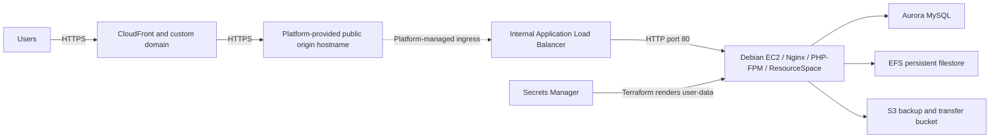

# BC Parks Digital Asset Management System

[ResourceSpace](https://resourcespace.com/) powers the BC Parks Digital Asset Management (DAM) system. This repository contains the application releases, BC Parks configuration, and Terraform/Terragrunt code used to deploy it in the BC Government AWS environment.

The current deployment installs ResourceSpace on Debian with Nginx and PHP-FPM. It does **not** use the previous Bitnami stack or containers.

## Architecture

The repository defines separate `dev`, `test`, and `prod` environments in AWS `ca-central-1`.



CloudFront uses a public Stratus origin hostname; the ALB created here is **internal**. The public origin's routing to the internal application depends on the hosting platform and is not provisioned by this repository. Do not configure CloudFront to connect directly to the internal ALB's DNS name as a public custom origin.

| Component | Current configuration |
| --- | --- |
| Edge and domains | Optional CloudFront distribution, enabled by default, with environment-specific aliases and HTTPS to the origin |
| Load balancer | Internal ALB in the existing Web subnets; ACM certificate for `internal.stratus.cloud.gov.bc.ca`; HTTPS listener forwarding HTTP to EC2 |
| Compute | Auto Scaling Group using a launch template; minimum, maximum, and desired capacity are all **1** |
| Runtime | Debian 13 base AMI; Nginx and PHP-FPM installed from configured APT repositories during bootstrap |
| Application | ResourceSpace release selected by `resourcespace_release_version` |
| Database | Encrypted Aurora MySQL 8.0-compatible cluster (`8.0.mysql_aurora.3.10.3`) with one Serverless v2 instance, scaling from 0.5 to 16 ACUs |
| Filestore | Encrypted EFS filesystem with mount targets in two Data subnets, mounted over NFS 4.1 at `/var/www/resourcespace/filestore` |
| Backup/transfer storage | S3 bucket `bcparks-dam-backup-<environment>`, mounted with `s3fs` at `/mnt/s3-backup` |
| Configuration and authentication | ResourceSpace settings and SimpleSAMLphp identity-provider configuration assembled during bootstrap using Secrets Manager values |
| Administration | AWS Systems Manager Session Manager; SSM Agent is installed during bootstrap |

This is a **single-application-node deployment**, not a horizontally scaled or zero-downtime configuration. EFS and Aurora persist independently of EC2 replacement; application code, installed packages, and local configuration are rebuilt on a new instance.

### Environment defaults

| Environment | Public application domain | EC2 type | Application source branch |
| --- | --- | --- | --- |
| dev | `dev-images.bcparks.ca` | `t3a.small` | `main` |
| test | `test-images.bcparks.ca` | `t3a.large` | `main` |
| prod | `images.bcparks.ca` | `t3a.large` | `main` |

Defaults are defined in [variables.tf](src/terraform/variables.tf); environment and branch selections are in the [Terragrunt environment directories](src/terraform/terragrunt).

### Request handling and background work

- CloudFront redirects HTTP viewers to HTTPS. Dynamic requests use the managed caching-disabled policy; `/filestore/*`, `/gfx/*`, `/css/*`, and `/js/*` use the managed caching-optimized policy.
- Nginx serves `/var/www/resourcespace` and sends PHP requests to the detected PHP-FPM Unix socket. It supplies the public HTTPS hostname to PHP and SimpleSAMLphp.
- The ALB checks `/bcgovhealthcheck`, a static Nginx response. A successful health check alone does not establish database, filestore, SAML, or bootstrap readiness.
- Media tooling includes ImageMagick, Ghostscript, FFmpeg, ExifTool, and ClamAV. APCu is also configured.
- Cron runs offline jobs every four minutes, static-sync ingestion every ten minutes, and filestore temporary-file cleanup daily.

## Repository layout

| Path | Purpose |
| --- | --- |
| [src/terraform](src/terraform) | AWS resources, variables, outputs, and shared Terragrunt backend configuration |
| [src/terraform/userdata.tpl](src/terraform/userdata.tpl) | Instance bootstrap: package installation, application deployment, storage mounts, configuration, and scheduled jobs |
| [src/terraform/terragrunt](src/terraform/terragrunt) | Environment-specific Terragrunt entry points |
| [src/resourcespace/releases](src/resourcespace/releases) | Vendored ResourceSpace releases; only the selected release is deployed |
| [src/resourcespace/files](src/resourcespace/files) | BC Parks application configuration, branding, SAML fragments, and runtime setup scripts |
| [src/resourcespace/tools](src/resourcespace/tools) | Operator-run EFS/S3 export and import setup scripts |
| [scripts](scripts) | Bash and PowerShell deployment helpers |
| [.github/workflows](.github/workflows) | Manually dispatched Terraform apply and destroy workflows |
| [documentation](documentation) | Additional architecture documents; some details predate the current deployment and should be checked against Terraform |

## Prerequisites

### Tools and access

- Git, AWS CLI, Terraform, and Terragrunt. The GitHub workflows currently use Terraform **1.14.3** and Terragrunt **0.55.16**.
- BC Government AWS access to the intended environment and permissions to deploy the resources and read the application secret.
- An approved Debian AMI available in the target region. The configured default is currently labelled Debian 13.4; bootstrap applies available package updates, rather than pinning an exact Debian point release.

### Existing platform resources

Terraform expects the following to exist; it does not create the hosting foundation:

- The environment VPC, Web/App/Data subnets, and pre-provisioned `Web`, `App`, and `Data` security groups.
- The ALB ACM certificate and platform routing for the public origin hostname.
- DNS for the application alias and, when CloudFront uses a custom domain, a suitable ACM certificate in `us-east-1`.
- The S3 Terraform state bucket `bcparks-dam-terraform-remote-state-<environment>`. The backend uses encryption and S3 lockfiles.
- The Secrets Manager secret `resourcespace_secrets` in each target environment.

The secret must be a JSON object containing the keys referenced by [main.tf](src/terraform/main.tf) and [cloudfront.tf](src/terraform/cloudfront.tf):

- Database: `mysql_username`, `mysql_password`.
- Email: `email_notify`, `email_from`.
- ResourceSpace keys: `spider_password`, `scramble_key`, `api_scramble_key`.
- SimpleSAMLphp: `technical_contact_name`, `technical_contact_email`, `secret_salt`, `auth_admin_password`, `saml_database_username`, `saml_database_password`, `sp_entity_id`, `idp_entity_id`, `single_signon_service_url`, `single_logout_service_url`, `x509_certificate`.
- CloudFront custom-domain certificate: `cf_certificate_arn`.

Do not commit secret values. Terraform reads this secret at **apply time** and embeds values in rendered user-data and application configuration; the EC2 application does not fetch it dynamically. Treat Terraform state, launch-template user-data, and bootstrap logs as sensitive.

## Deploying or updating an environment

### Local deployment

Copy the example local configuration:

```bash
cp .env.example .env
```

Set `licenceplate` in `.env`, then obtain temporary AWS credentials for the correct environment through the BC Government AWS login application.

The root Terragrunt configuration requires the `licenceplate` environment variable. The Terraform `licence_plate` input has a separate default in [variables.tf](src/terraform/variables.tf); if deploying under a different licence plate, override that input as well. Loading `.env` alone does not override it.

The helpers load `.env`, initialize Terragrunt, and apply **without an interactive approval prompt**:

```bash
# Bash
./scripts/run-terragrunt.sh dev
```

```powershell
# PowerShell
./scripts/run-terragrunt.ps1 -Environment dev
```

Replace `dev` with `test` or `prod` as appropriate. For a reviewed plan and interactive apply, export `licenceplate` first (direct Terragrunt commands do not load `.env` automatically), then run:

```bash
cd src/terraform/terragrunt/dev
terragrunt init
terragrunt plan
terragrunt apply
```

### GitHub Actions

Run the [terraform apply workflow](.github/workflows/terraform_apply.yml) manually and select the target GitHub environment. Each GitHub environment requires:

- `TERRAFORM_DEPLOY_ROLE_ARN`: deployment role assumed using GitHub OIDC.
- `LICENCE_PLATE`: exported as `licenceplate` for Terragrunt.

The workflow initializes Terragrunt and applies with `-auto-approve`.

All three Terragrunt environments currently configure bootstrap to clone `main`. Selecting another workflow branch does not, by itself, change the application branch cloned by new instances.

### Instance bootstrap and deployment verification

The [user-data template](src/terraform/userdata.tpl) installs SSM, updates packages, installs the runtime, clones the configured branch using sparse checkout, and copies the selected ResourceSpace release into `/var/www/resourcespace`. It then mounts EFS and S3, builds application/SAML configuration, installs branding and supporting tools, configures cron, and restarts services.

After applying:

1. Check the Auto Scaling Group activity and ALB target health.
2. Connect through EC2 **Connect > Session Manager** once SSM becomes available.
3. Check `/var/log/userdata.log` for errors and the final `Userdata script completed successfully` message.
4. Verify the EFS and S3 mounts, ResourceSpace login/SAML flow, database access, uploads, previews, and background processing.
5. Read the environment outputs with `terragrunt output` for the application URL, ALB DNS name, database endpoint, and CloudFront identifiers.

Terraform apply returning successfully does not mean bootstrap has finished: the ASG is configured not to wait for capacity.

### Application updates and secret changes

- Update shared settings in [src/resourcespace/files](src/resourcespace/files), not only on a running VM.
- To deploy a different ResourceSpace release, add/select its directory under [releases](src/resourcespace/releases) and update `resourcespace_release_version`.
- After changing secrets, apply Terraform again to render updated user-data.
- Ensure an instance refresh/replacement has completed to run the new bootstrap. Applying Terraform or restarting Nginx/PHP-FPM alone is not proof that new code or secrets are active.
- Before a ResourceSpace release upgrade, take recoverable database and filestore backups and follow the upstream upgrade procedure.

The bootstrap does not contain a complete fresh-database initialization or database-import procedure. For a new environment, plan the ResourceSpace database setup or migration separately; the old Bitnami credential and local-database extraction steps no longer apply.

## Operations

### Access, logs, and service checks

On the instance:

```bash
# Bootstrap and cloud-init status; logs may contain sensitive values
sudo cloud-init status --long
sudo tail -n 100 /var/log/userdata.log

# Web server and PHP-FPM status (discover the installed PHP version)
sudo nginx -t
systemctl list-units --all 'php*-fpm.service'
sudo systemctl status nginx
sudo tail -n 100 /var/log/nginx/error.log

# Persistent mounts and background processing
findmnt /var/www/resourcespace/filestore
findmnt /mnt/s3-backup
sudo tail -n 100 /var/log/resourcespace-offline-jobs.log
```

Restart Nginx and the installed PHP-FPM service using `systemctl`, for example `sudo systemctl restart nginx php8.4-fpm`. Confirm the PHP service name first. The Bitnami `ctlscript.sh` command and `/opt/bitnami` paths are no longer applicable.

ResourceSpace's **System > Installation Check** is also useful for application-level diagnostics. Static-sync output is written to the EFS-backed `filestore/staticsync.log`.

### Package patching and reboots

The current bootstrap runs `apt-get update` and `apt-get full-upgrade` once during instance creation. This updates packages from the configured repositories; it neither pins Debian 13.7 nor implements ongoing scheduled patching. This is a temporary measure in place until a newer approved Debian AMI is released.

Coordinate regular patching with the hosting/security team. Verify Debian package revisions against vendor advisories, restart affected services, and reboot when necessary to activate an updated kernel. The bootstrap currently does **not** reboot automatically. Check mount persistence and application readiness during any reboot procedure; EFS and S3 mounts are issued directly by bootstrap rather than installed as persistent mount units.

Rescan after patching and rebooting. A Debian point-release number or successful bootstrap is not evidence that every vulnerability has been remediated.

### Backups and file transfers

- Aurora automated backup retention is configured for **five days**.
- ResourceSpace files live on EFS, not the EC2 root disk.
- AWS Backup plans are currently set up manually.
- The Terraform-managed transfer bucket is `bcparks-dam-backup-<environment>` and is mounted at `/mnt/s3-backup`. Operators can also use the AWS S3 console or CLI to transfer objects.
- Bootstrap copies the [EFS-to-S3 export setup](src/resourcespace/tools/efs-to-s3-export-setup.sh) and [S3-to-EFS import setup](src/resourcespace/tools/s3-to-efs-import-setup.sh) scripts into the mounted bucket. It does not execute them or configure a recurring filestore backup.

## Tearing down an environment

**Destructive operation:** take and verify independent database and filestore backups before attempting teardown. Aurora is configured with `skip_final_snapshot = true`, so destruction does not create a final recovery snapshot.

After exporting `licenceplate` and authenticating to the correct AWS account:

```bash
cd src/terraform/terragrunt/dev
terragrunt plan -destroy
terragrunt destroy
```

The [terraform destroy workflow](.github/workflows/terraform_destroy.yml) also supports manual teardown and requires the confirmation text `delete all data`.

EFS and the backup S3 bucket have Terraform `prevent_destroy` protection, so a full destroy plan is expected to be blocked unless their lifecycle protection is deliberately addressed. Do not remove those safeguards without an approved data-retention and recovery plan.
